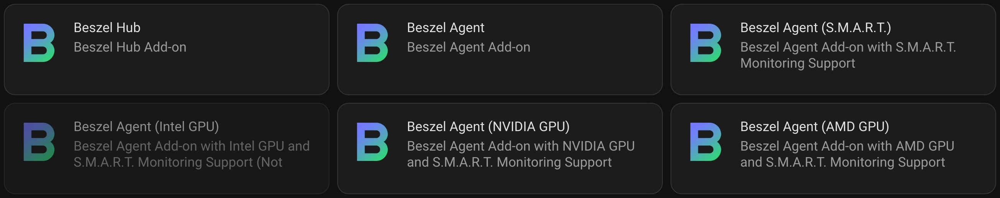
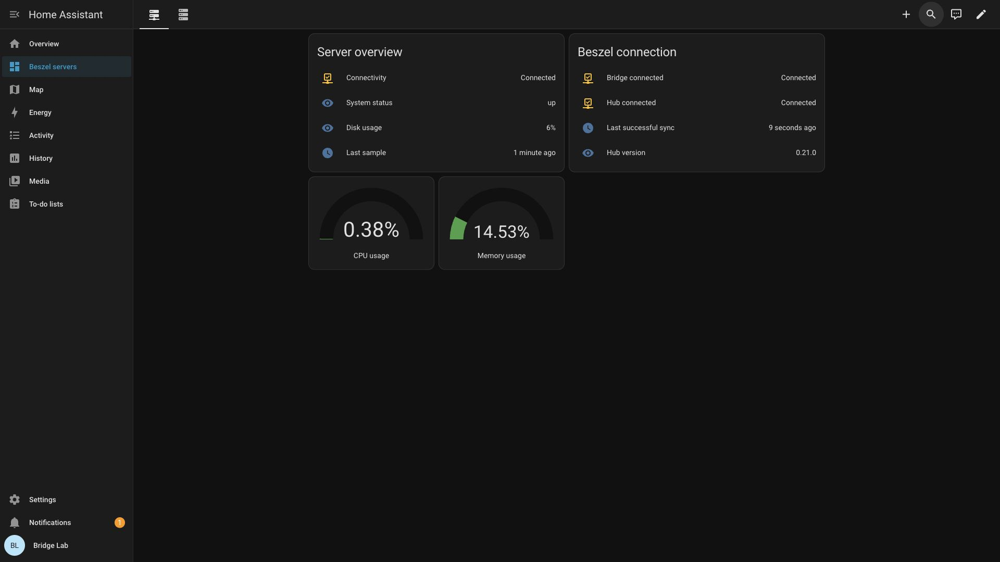

# Beszel for Home Assistant

Monitor Home Assistant and other machines with [Beszel](https://github.com/henrygd/beszel). Run a Hub to view readings and an Agent on each monitored host.

## Quick installation

Add this repository with the button below, or paste `https://github.com/vineetchoudhary/home-assistant-beszel-agent` into **Settings > Apps > Install app > ⋮ > Repositories**.

1. Use an existing Hub, or [set up Beszel Hub](beszel_hub/DOCS.md) and create its first account.
2. Install **Beszel Agent**. In the Hub, choose **Add System**, copy its public key and token into the Agent's `key` and `token` options, and set `hub_url` to your Hub's address.
3. Save and start the Agent, then check the Hub for live metrics.

See the [illustrated installation guide](docs/INSTALLATION.md) for the full setup.

## Beszel Bridge

[Beszel Bridge](beszel_bridge/DOCS.md) brings Hub readings into Home Assistant through MQTT.

## Documentation

- [App selection and configuration](docs/APPS.md)
- [Home Assistant dashboard setup](docs/dashboards/beszel/SETUP.md)

[Report an issue](https://github.com/vineetchoudhary/home-assistant-beszel-agent/issues) · [Contributing](docs/CONTRIBUTING.md) · [MIT license](LICENSE)
