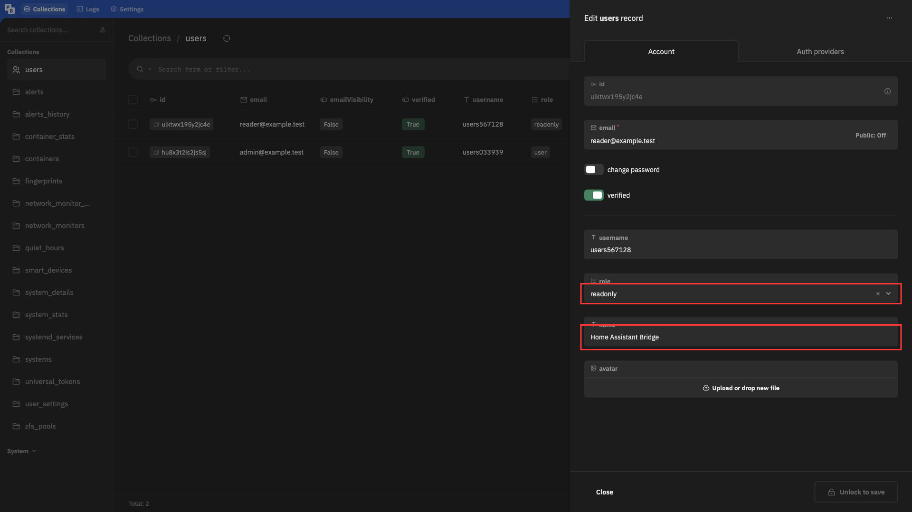
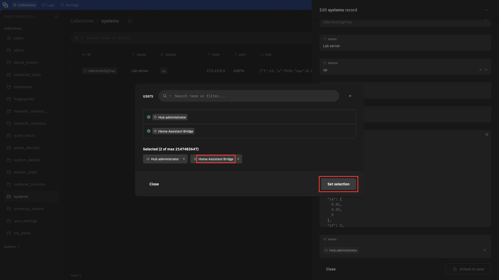
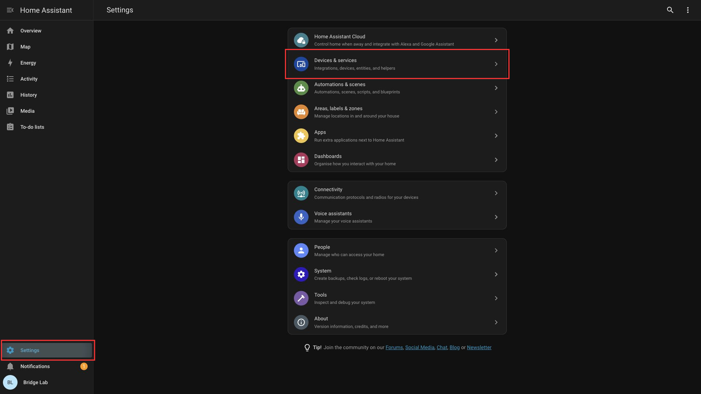
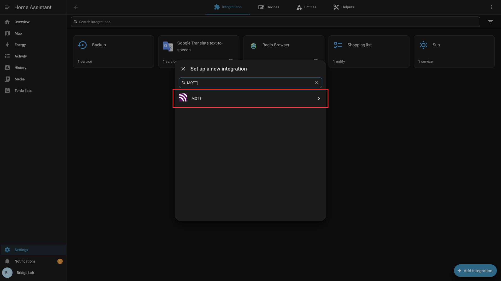
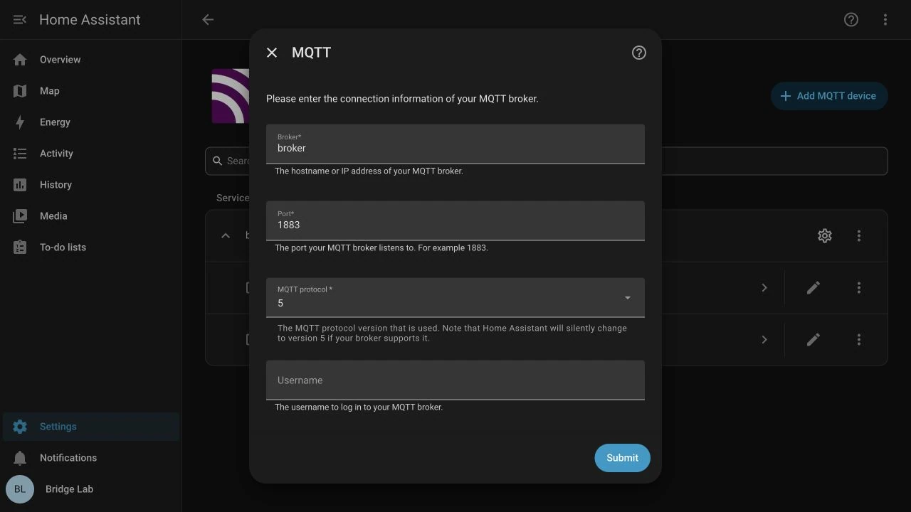
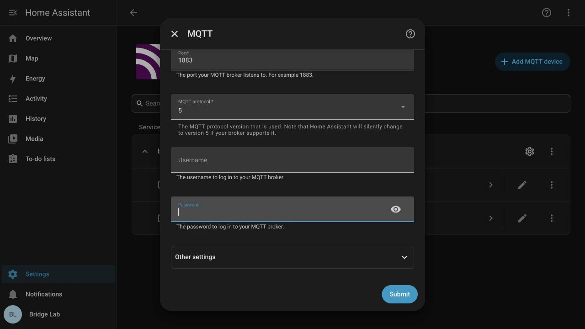
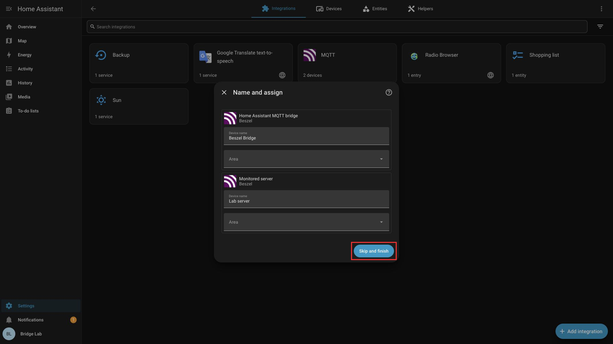
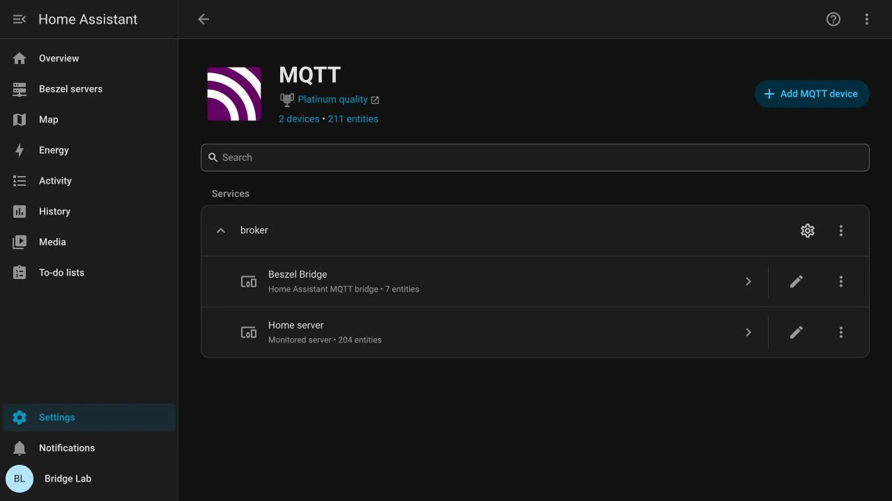
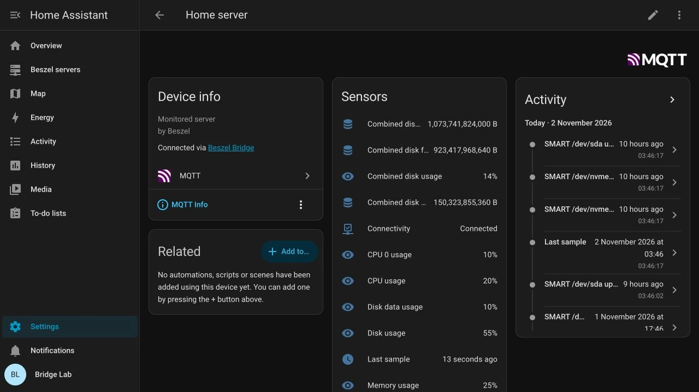
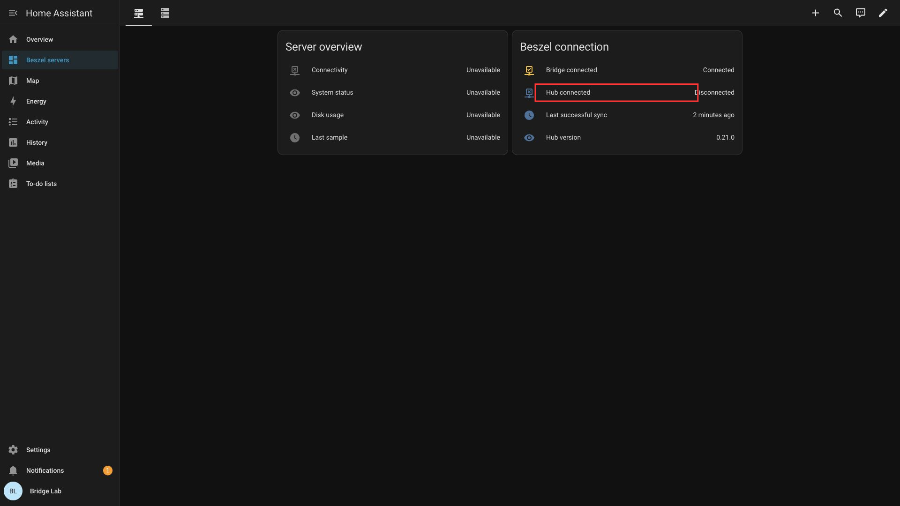

# Beszel Bridge

Expose a local or remote Hub as Home Assistant MQTT devices and entities. **Unreleased development preview.** See [readiness](https://github.com/vineetchoudhary/home-assistant-beszel-agent/blob/main/docs/BRIDGE_READINESS.md) before installation or publishing.

## Requirements

- HA **2026.10.1 or newer**, the first tested version, plus an MQTT broker and HA's MQTT integration.
- Hub **0.20.0 or 0.21.0**, as listed in [compatibility.json](https://github.com/vineetchoudhary/home-assistant-beszel-agent/blob/main/beszel_bridge/compatibility.json).
- A normal password-authenticated account with shared systems, preferably `readonly`. Superuser credentials, Agent tokens, OAuth-only accounts and interactive MFA are unsupported.
- One Bridge publisher per Hub per HA installation. HACS and Agent changes are unnecessary.

The Bridge supports **amd64 and aarch64**. It uses normal app networking and can run with Protection mode enabled. No inbound host port or hardware access is required.

## Setup overview

1. Prepare a dedicated normal Hub account and share the systems it should monitor, as shown below.
2. Start an MQTT broker and connect Home Assistant's MQTT integration to that same broker. The Bridge does not install a broker or configure the integration for you.
3. Set the Hub URL, account credentials and MQTT options in the app's **Configuration**. Use the local or remote Hub example below. Leave system and metric lists empty to monitor everything available to the account.
4. Save and start the app. Check its log for `Bridge synchronized`, then open the MQTT integration to verify its devices and entities. Save and restart after later configuration changes.

## Prepare the Hub account

1. Open the Hub's `/_/` admin panel, including any base path, and sign in as a PocketBase superuser. In **users**, create an account with an email, password, name and **readonly** role.

   

2. In **systems**, open each server's **users** picker, add the Bridge account and retain the owner's account. Choose **Set selection** and save.

   

Use the new normal account for the Bridge. The superuser login is only for account management. See [Beszel account roles](https://www.beszel.dev/guide/user-accounts).

## Hub running as an HA app

Use the Hub's actual internal hostname from installed-app metadata and its API port `8090`. `localhost` points to the Bridge itself.

```yaml
hub_url: "http://ACTUAL_HUB_APP_HOSTNAME:8090"
hub_email: "ha-monitor@example.com"
hub_password: "your-dedicated-account-password"
mqtt_source: supervisor
```

Include any Hub base path. Use the direct API URL: Ingress URLs, port `8099` and `ingress_user` serve browser access. Bridge access needs no published Hub port, although the Hub's own watchdog may require it.

## Hub running on another machine

Keep the existing Hub and Agents running. Use the same options with a reachable LAN, VPN or reverse-proxy URL:

```yaml
hub_url: "https://monitoring.example.com/beszel"
```

Use HTTPS outside trusted networks. For a private CA, set `hub_ca_file: "/ssl/beszel-ca.crt"` to a readable PEM file. Hostnames and certificates are always verified. Browser-only SSO needs a separately supported noninteractive login method. The remote host needs no inbound Bridge port or HA API access.

## MQTT configuration

`mqtt_source: supervisor` uses the installed broker app's Supervisor service. HA must use the same broker and discovery prefix. For another broker:

```yaml
mqtt_source: manual
mqtt_host: "mqtt.example.com"
mqtt_port: 8883
mqtt_username: "beszel-bridge"
mqtt_password: "your-broker-password"
mqtt_tls: true
mqtt_ca_file: "/ssl/mqtt-ca.crt"
```

`mqtt_host` accepts a hostname/IP. Leave `mqtt_ca_file` empty for publicly trusted TLS. Plain MQTT usually uses port `1883`. App options and HA backups can contain credentials even when fields are masked.

### Connect Home Assistant to MQTT

Skip this if HA already uses the same broker. Enter your own broker settings instead of the example test hostname `broker`.

1. Open **Settings > Devices & services**.

   

2. Choose **Add integration**, search for **MQTT** and select it, including a second picker if shown.

   

3. Enter broker address, port and credentials. Match **Other settings** to its TLS requirements.

   

   

4. Submit and finish. Assign device areas or choose **Skip and finish**.

   

## Configuration reference

Every option available in the app configuration is listed below. Required Hub connection fields start as `null` and must be filled before the Bridge can run.

### Hub options

| Option | Default | Purpose |
| --- | --- | --- |
| `hub_url` | `null`, required | Direct HTTP or HTTPS Hub URL, including its API port and any base path. Ingress URLs, embedded credentials, query strings and fragments are rejected. |
| `hub_email` | `null`, required | Email address of the normal password-authenticated Hub account that can see your selected systems. |
| `hub_password` | `null`, required | That account's password. Agent tokens and PocketBase superuser credentials do not work here. |
| `hub_ca_file` | `""` | Optional absolute path to a PEM CA file inside `/ssl`, such as `/ssl/beszel-ca.crt`, for a privately signed HTTPS Hub. Empty uses the system trust store. |

Include the Hub's base path when one is configured. Use its direct API port `8090` for the Hub app, rather than its internal Ingress proxy on `8099`. Certificate and hostname verification remain enabled.

### MQTT options

| Option | Default | Purpose |
| --- | --- | --- |
| `mqtt_source` | `supervisor` | `supervisor` obtains broker settings from the installed broker app's Supervisor service. `manual` uses the fields below. |
| `mqtt_host` | `""` | Required in manual mode. Broker hostname or IP address without a scheme, port or path. |
| `mqtt_port` | `1883` | Manual broker port, from `1` to `65535`. Plain MQTT commonly uses `1883` and TLS commonly uses `8883`. |
| `mqtt_username` | `""` | Manual broker username. Empty is suitable only if your broker permits that authentication mode. |
| `mqtt_password` | `""` | Manual broker password. Keep this and the Hub password private. |
| `mqtt_tls` | `false` | Enable TLS for a manual broker connection. Match the broker's TLS listener and port. |
| `mqtt_ca_file` | `""` | Optional absolute path to a PEM CA file inside `/ssl`, such as `/ssl/mqtt-ca.crt`. Empty uses system trust. Applies to TLS connections in either source mode. |

Supervisor mode replaces the host, port, username, password and TLS flag with service-provided values. Entering manual fields while leaving `mqtt_source: supervisor` does not override that service. If the service is unavailable, install/start the broker app or choose manual mode.

Home Assistant and the Bridge must use the same broker. Copy private CA files into Home Assistant's `/ssl` folder before starting the Bridge. Invalid or unreadable CA files prevent setup. Both CA options require a file path inside `/ssl`, which the app mounts read-only.

### Selection, polling and lifecycle options

| Option | Default | Purpose |
| --- | --- | --- |
| `include_systems` | `[]` | List of system record IDs to monitor. Empty selects every system accessible to the Hub account. IDs must contain exactly 15 lowercase letters or digits. |
| `exclude_systems` | `[]` | List of system record IDs to omit. Exclusions take precedence over inclusions. The same ID format applies. |
| `metrics` | `[]` | List of metric keys from the table below. Empty enables all supported metrics. System status, connectivity and Bridge diagnostics are always exposed. |
| `poll_interval` | `30` | Seconds between polls, from `15` to `300`. Polling does not change the timestamps of the Hub's source samples. |
| `stale_after` | `0` | Maximum sample age in seconds. `0` uses `max(180, 3 × poll_interval)`. An explicit value must meet that minimum and cannot exceed `86400`. |
| `discovery_prefix` | `homeassistant` | MQTT discovery prefix used by Home Assistant. Only letters, numbers, underscores and hyphens are accepted. Clean up with the old setting before changing it. |
| `ha_status_topic` | `homeassistant/status` | Home Assistant MQTT birth topic. Receiving `online` triggers a refresh. Match any customized HA setting. Empty topics and MQTT wildcards are rejected. |
| `cleanup` | `false` | Set `true` for a one-shot removal of this Bridge's owned discovery and availability topics, then exit. Follow the cleanup procedure below and return it to `false` for normal operation. |

## Selecting systems and metrics

Use stable system record IDs from the Hub or `bridge check`:

```yaml
include_systems:
  - "abc123def456ghi"
exclude_systems: []
metrics:
  - cpu_usage
  - memory_usage
  - disk_usage
  - temperature
  - network_receive
  - network_transmit
  - uptime
  - last_sample
poll_interval: 30
stale_after: 0
discovery_prefix: homeassistant
ha_status_topic: homeassistant/status
cleanup: false
```

Empty include/metric lists select all accessible systems/supported metrics. Exclusions win. Use record IDs rather than system names. Status and connectivity are always exposed. Match `ha_status_topic` to HA's MQTT birth topic if customized.

Polling supports `15` to `300` seconds. With `poll_interval: 30`, automatic freshness is `180` seconds. With `poll_interval: 300`, it is `900` seconds. Freshness follows the latest `1m` sample's `created` time, never a successful re-poll or system rename.

## Entities and history

### Check the discovered devices

Start the Bridge and check for `Bridge synchronized` in its log. Open **Settings > Devices & services > MQTT** for the Bridge device and one device per selected server.



Open a server's sensors and the Bridge's connection diagnostics, then follow the [dashboard setup](https://github.com/vineetchoudhary/home-assistant-beszel-agent/blob/main/docs/dashboards/beszel/SETUP.md#add-a-dashboard).



### Available readings

Use these exact keys in the `metrics` list:

| Metric key | Reading |
| --- | --- |
| `cpu_usage` | CPU usage, percent. |
| `memory_usage` | Memory usage, percent. |
| `disk_usage` | Primary disk usage, percent. |
| `temperature` | Highest observed temperature sensor reading, °C. Appears after a real sensor is observed. |
| `network_receive` | Receive rate, bytes per second (`B/s`). |
| `network_transmit` | Transmit rate, bytes per second (`B/s`). |
| `uptime` | Uptime, seconds. |
| `last_sample` | The source sample's timestamp. |

Missing or stale telemetry stays unavailable. Selecting a metric does not create support for a sensor that the Hub has never reported.

A confirmed `down` system has connectivity off. Paused/pending systems do not claim an active connection. Hub outages make readings unavailable while the Bridge's liveness watchdog remains healthy.

Identity uses the Hub's public SSH key and stable system ID. Renaming servers, changing the same Hub's URL and HA entity customization preserve identity. Explicit exclusions remove discovery immediately. Inaccessible systems have a five-minute grace period after complete successful inventories. Failed inventories never delete devices.

HA history starts when entities report. Older history remains in Beszel. Container, GPU, S.M.A.R.T. and extra filesystem entities are deferred.

## Diagnostics and recovery

Run these commands inside the Bridge app container:

```sh
/usr/local/bin/bridge status
/usr/local/bin/bridge check
/usr/local/bin/bridge health
```

`status` reports redacted readiness. `check` authenticates and lists selected systems, source times and freshness without publishing. `health` checks process liveness. Logs omit passwords, tokens and API response bodies. Redact exported system names/IDs before sharing.

| Problem | Check |
| --- | --- |
| Hub connection/TLS | URL, internal hostname, base path, network and CA |
| Login/no systems | Normal account, password login, shared systems and filters |
| MQTT service unavailable | Broker app service or manual settings |
| Missing HA entities | Same broker, discovery prefix and successful sync |
| Unavailable readings | Agent status, source freshness and Hub connection |
| Unsupported version | Verified Hub version and compatibility policy |



The Bridge publishes no host port. Its internal port `8099` serves `/health` and redacted `/status` for app diagnostics. A healthy Watchdog confirms process liveness even while the Hub or MQTT broker is unreachable.

Include the app in Home Assistant backups to preserve its `/data` identity and owned discovery topics. A process lock prevents concurrent state access.

### Clean up or replace a Hub/broker

Before uninstalling, switching brokers/prefixes, replacing the Hub or rotating its SSH key:

1. Retain the original Hub/broker settings. Temporarily disable Watchdog and automatic start.
2. Set `cleanup: true`, save and restart. Confirm scoped discovery/availability removal in the log.
3. Set `cleanup: false`, apply new settings, start the app and restore Watchdog/automatic start.

If the old broker is offline, preserve its configuration and `/data`, then retry. Deleting app data first can leave retained discovery behind. Cleanup must preserve unrelated topics.

## Development installation before images are published

Copy `beszel_bridge` into HA's local apps directory and remove `image:` from that local copy so Supervisor builds it. Keep the repository manifest unchanged. Complete the [manual HA OS checklist](https://github.com/vineetchoudhary/home-assistant-beszel-agent/blob/main/docs/MANUAL_CHECKLIST.md) before release. Publishing remains blocked by `release_ready: false`.
