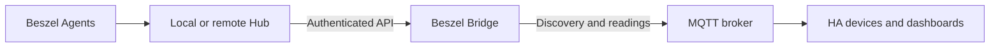

# Architecture

Agents collect host metrics, the Hub stores and displays them, and the optional Bridge exposes them to Home Assistant.

| App | Runtime | Ports and storage |
| --- | --- | --- |
| Agent | `run.sh` reads bashio options and starts Beszel plus an HTTP health helper | Agent `45876`, watchdog `45877`, app data persists |
| Hub | Beszel server with an internal Ingress proxy | API/UI/watchdog `8090`, Ingress `8099`, database and keys in app data |
| Bridge | Go HTTP collector, typed metric adapters and MQTT publisher | Internal `8099/health` and redacted `8099/status`, identity/manifest under `/data` |

Agent/Hub images use Alpine except NVIDIA, which uses Debian for injected glibc tools and the amd64 NVML build. Intel is amd64-only because `intel_gpu_top` is unavailable on aarch64. See [app variants](APPS.md).

The Bridge uses a normal Hub account, read-only `/ssl`, normal container networking and no published port or hardware privileges. [Compatibility policy](../beszel_bridge/compatibility.json) selects verified Hub schemas. Source timestamps control freshness, while the Hub's public SSH key and system ID define identity. Discovery is retained, live readings are not, and liveness is independent of upstream readiness.

Hub backups stop the server for SQLite consistency. Bridge backups preserve identity and owned topics. See [Hub configuration](../beszel_hub/DOCS.md), [Bridge setup](../beszel_bridge/DOCS.md) and pending [release gates](BRIDGE_READINESS.md).
