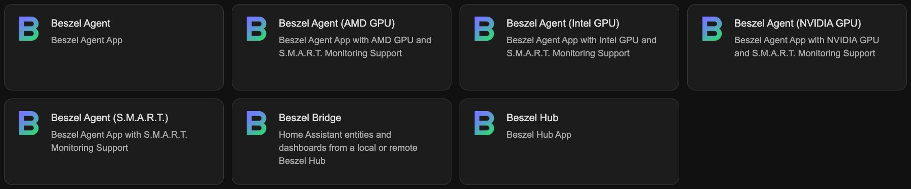

# Install Beszel in Home Assistant

These apps require Home Assistant's app store. Choose the [Agent variant](APPS.md) for your hardware. To bring Hub readings into Home Assistant, follow the [Bridge setup guide](../beszel_bridge/DOCS.md).

## 1. Add the repository

Open **Settings > Apps > Install app > ⋮ > Repositories**, choose **Add** and enter:

```text
https://github.com/vineetchoudhary/home-assistant-beszel-agent
```


Return to the app store to see the Beszel apps:



## 2. Set up a Hub

Skip this if you already have a Beszel Hub. Otherwise, install **Beszel Hub**, set `app_url` to `http://<home-assistant-ip>:8090`, save and start it. Open that URL and create the first account.

Replace `<home-assistant-ip>` with the address shown under **Settings > System > Network**. For Ingress, reverse proxies and automatic login, see [Hub configuration](../beszel_hub/DOCS.md).

## 3. Configure an Agent

Install your chosen Agent variant. In the Hub, choose **Add System** and copy the complete public key and token into the Agent's **Configuration**. Set `hub_url` to the Hub's direct address, including any port and base path. If the Hub asks for the monitored host, use Home Assistant's IP address and port `45876`.

```yaml
key: "ssh-ed25519 REPLACE_WITH_YOUR_HUB_PUBLIC_KEY"
hub_url: "http://192.168.1.100:8090"
token: "replace-with-system-token"
```

Replace `192.168.1.100` with the Hub host's IP address. Home Assistant Ingress URLs cannot be used as `hub_url`.


Before starting, set **Protection mode** for the metrics you need. Disabling it grants the app broader host access.

| Metrics | Protection mode |
| --- | --- |
| Basic system metrics or AMD GPU usage | Can remain enabled. |
| Home Assistant app statistics or S.M.A.R.T. disk health | Disable. |
| Intel Arc/Xe GPU usage | Disable. Older i915 GPUs may work with it enabled. |
| NVIDIA GPU usage | Requires a [specially configured host](../beszel_agent_nvidia/DOCS.md#nvidia-host-requirements). Unavailable on HA OS. |

## 4. Start and verify

Save the configuration, open **Info** and choose **Start**. Check the **Log** tab for errors and confirm live readings in the Hub. Save and restart the app after changing configuration.


## Optional settings and troubleshooting

Use the [app's configuration guide](APPS.md) for private HTTPS certificates, environment variables, disk selection and GPU settings. `custom_volumes` only checks existing paths inside an app and cannot mount host directories.

If readings are missing, check the Hub URL, key, token and both apps' logs. Stop other Agent variants before starting one because they share ports. For unresolved problems, [report an issue](https://github.com/vineetchoudhary/home-assistant-beszel-agent/issues) with app/HA versions and logs with credentials removed.
