# Beszel installation and setup

Choose a variant in the [app guide](APPS.md). These steps cover Agents, with Hub setup in step 8. For the development preview, use the [Bridge guide](../beszel_bridge/DOCS.md).

Older screenshots use **Add-ons**, now called **Apps**. See [capture notes](SCREENSHOTS.md).

## 1. Open Home Assistant Apps

Open **Settings > Apps**.

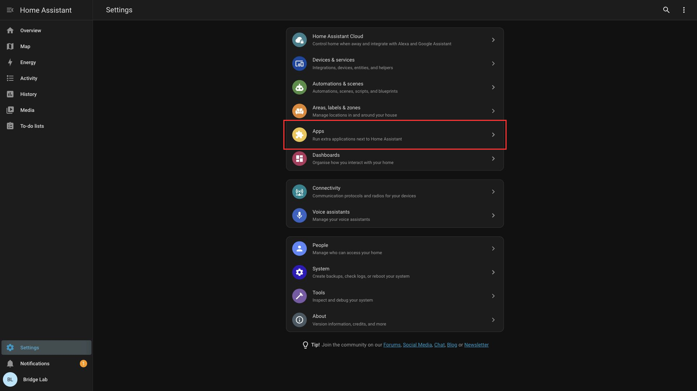

## 2. Open the App store

Choose **Install app**.

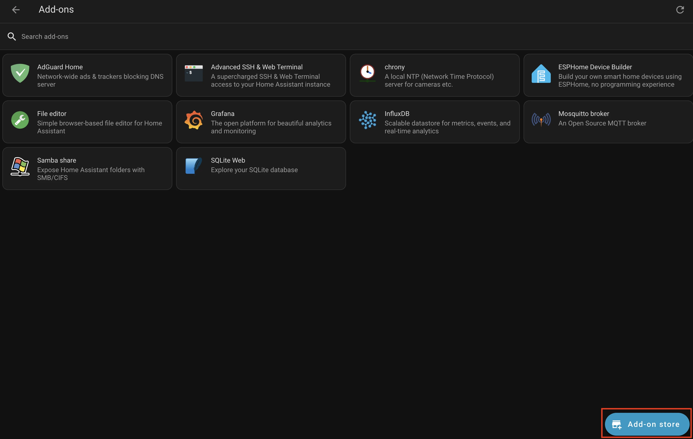

## 3. Open App Store Repositories

Open the three-dot menu and choose **Repositories**.

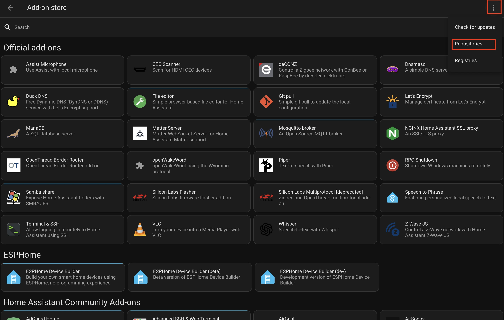

## 4. Add Custom Repository

Add `https://github.com/vineetchoudhary/home-assistant-beszel-agent`.

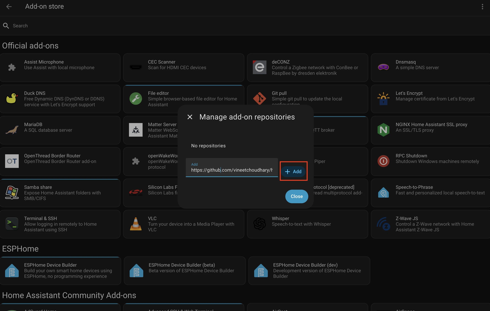

## 5. Confirm Repository Added

Select an app from the repository. See [app differences and requirements](APPS.md).

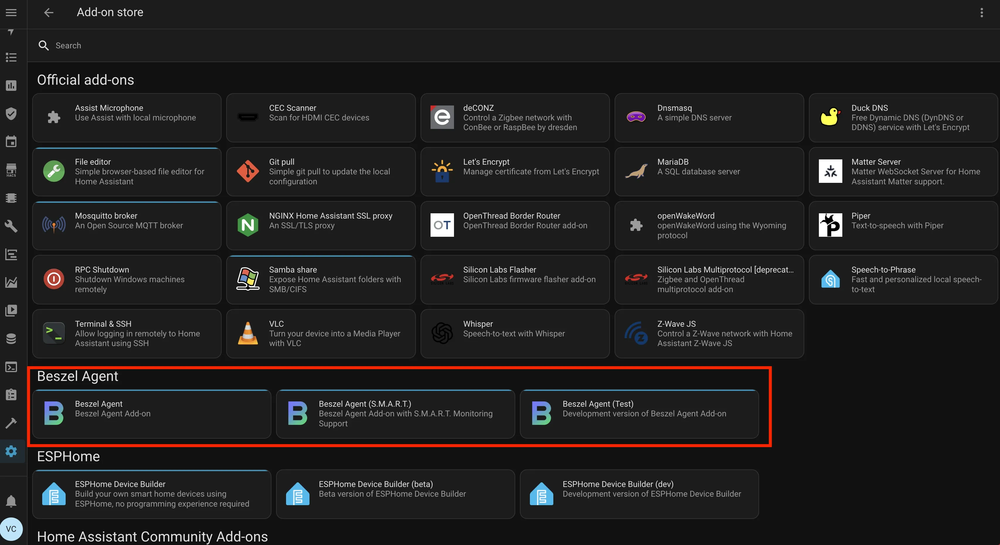

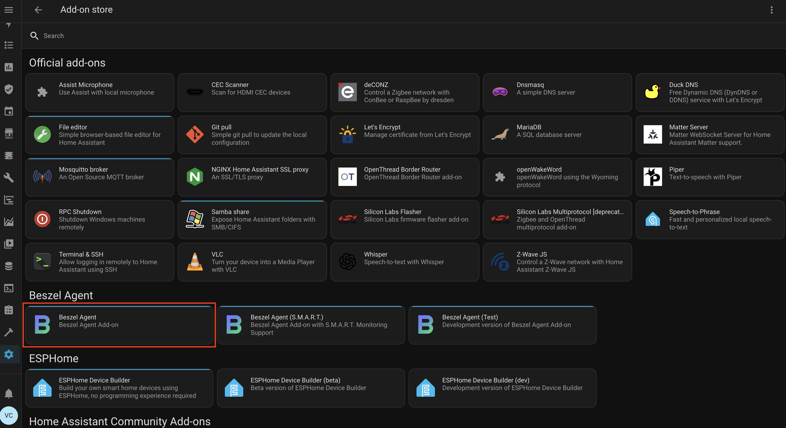

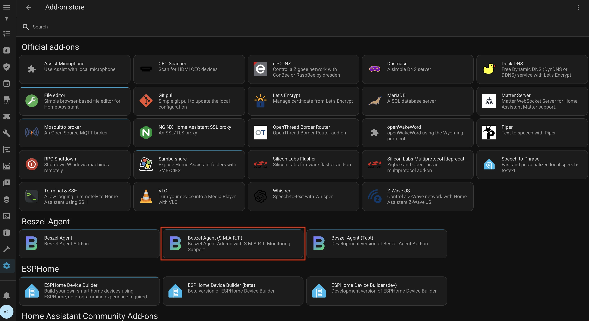

## 6. Install a Beszel App

Open the app and choose **Install**.

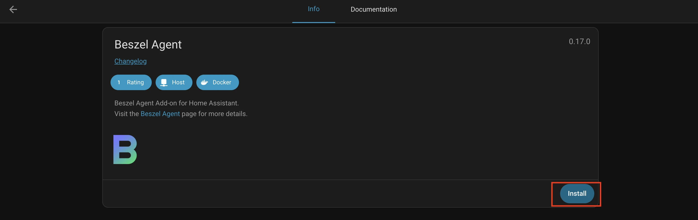

## 7. Open App Configuration

Open **Configuration** after installation.

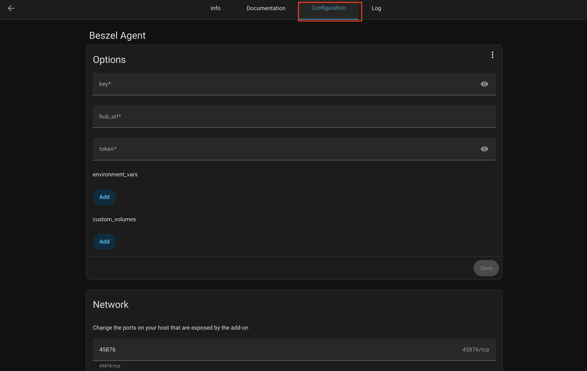

## 8. Fill in Required Configuration

**Hub:** start with defaults, open `http://<home-assistant-host>:8090` and create the first account. See [Hub options](../beszel_hub/DOCS.md) for `app_url`, Ingress and authentication.

**Agent:** in your Hub, choose **Add System** and copy the public key and token. Enter those values and the Hub's reachable URL:

```yaml
key: "your-hub-public-key"
hub_url: "http://192.168.1.100:8090"
token: "your-secret-token"
```

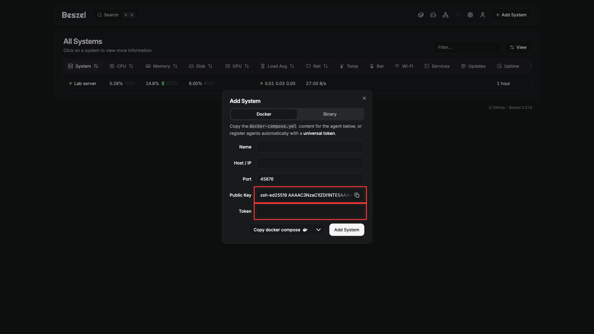

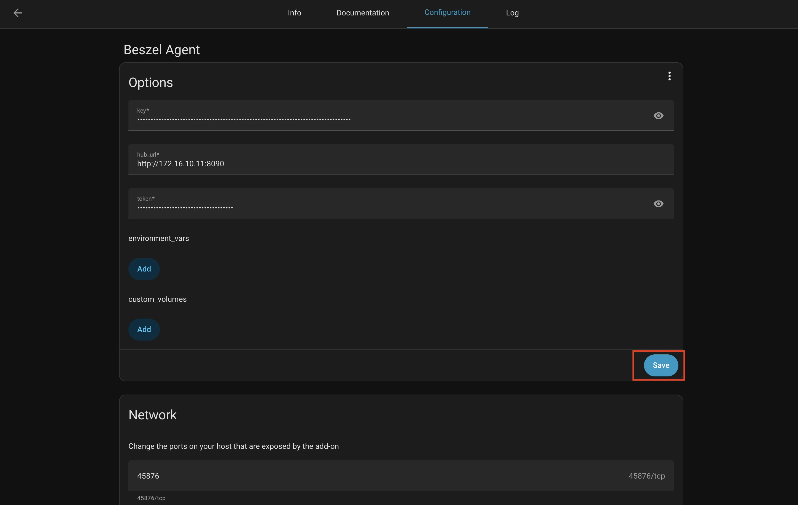

## 9. (Optional) Configure Custom Environment Variables and Volumes

### Environment variables

Use `environment_vars` for [upstream Agent options](https://www.beszel.dev/guide/environment-variables#agent):

```yaml
environment_vars:
  - name: LOG_LEVEL
    value: "debug"
  - name: SMART_DEVICES
    value: "/dev/nvme0:nvme,/dev/sda:sat"
```

### Self-signed certificates

Agents verify HTTPS certificates. For a private or self-signed CA, copy its PEM certificate into HA's `/ssl` folder, mounted read-only by the app:

```yaml
hub_url: "https://beszel.example.com"
environment_vars:
  - name: CA_CERT_FILE
    value: "/ssl/beszel-ca.crt"
```

An unreadable or invalid CA file stops startup with a `CA_CERT_FILE` error and can cause watchdog restarts. Leave this option unset for HTTP or publicly trusted HTTPS.

### Custom volume checks

```yaml
custom_volumes:
  - host_path: "/mnt/data"
    container_path: "/mnt/data:ro"
```

**This option only checks existing paths inside the app.** It cannot mount arbitrary host directories. Home Assistant controls the app's mounts through `config.yaml`.

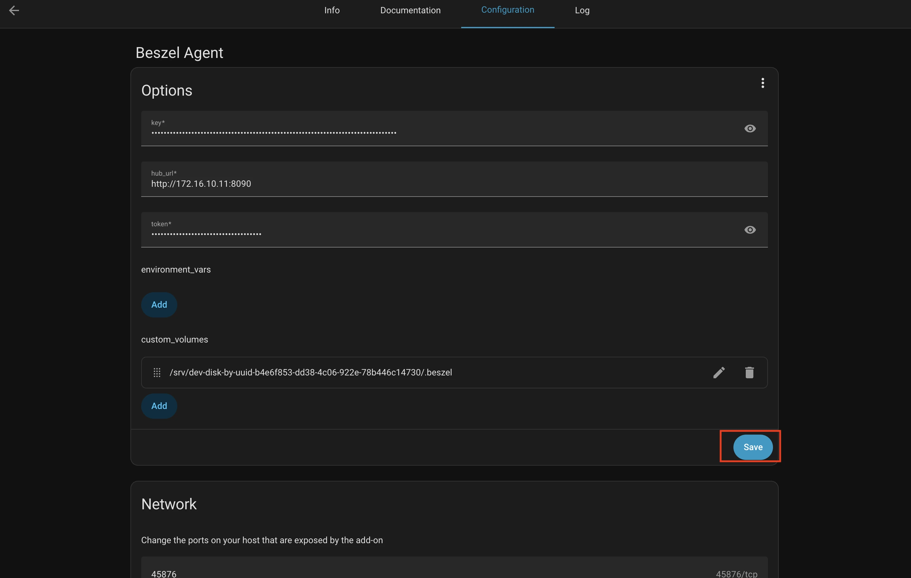

## 10. Start the App

Save the configuration, open **Info** and choose **Start**.

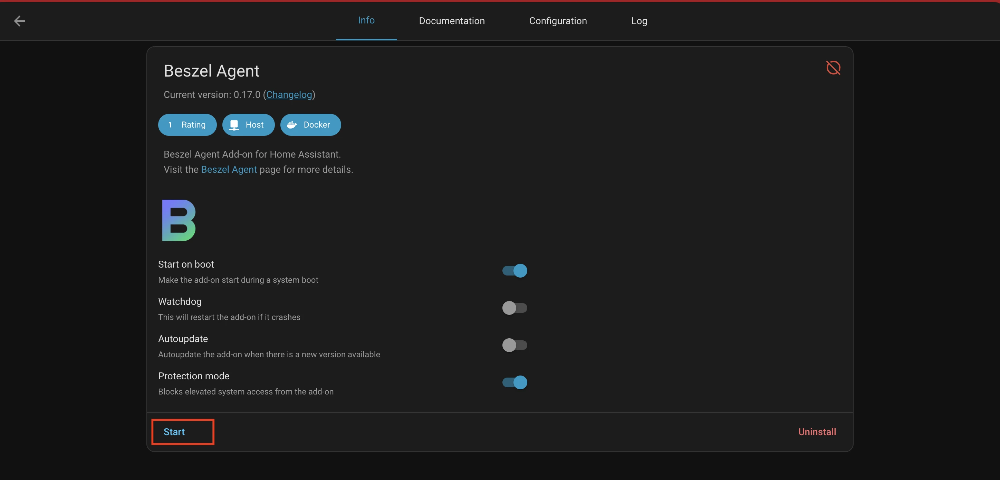

## 11. Observe App Running

Check the app status and logs for connection errors or detected disks.

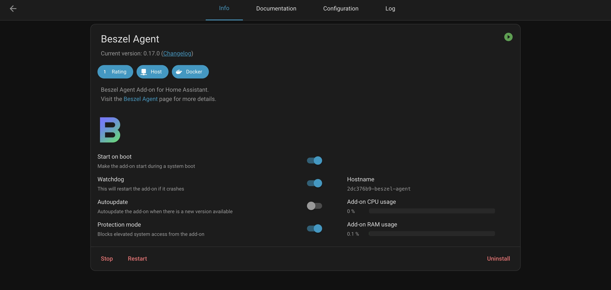

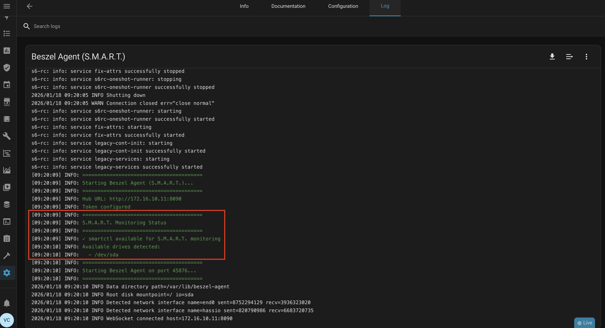

| Port | Purpose |
| --- | --- |
| `45876` | Agent connection from the Hub |
| `45877` | Agent watchdog healthcheck |
| `8090` | Hub web UI, API and watchdog |

## 12. (Optional) Disable Protection Mode

Disable Protection mode for Docker app statistics, S.M.A.R.T. and Intel Arc/Xe monitoring. Basic `/dev/dri` access works in either mode. Disabling protection grants broader host access, so use it only for trusted apps.

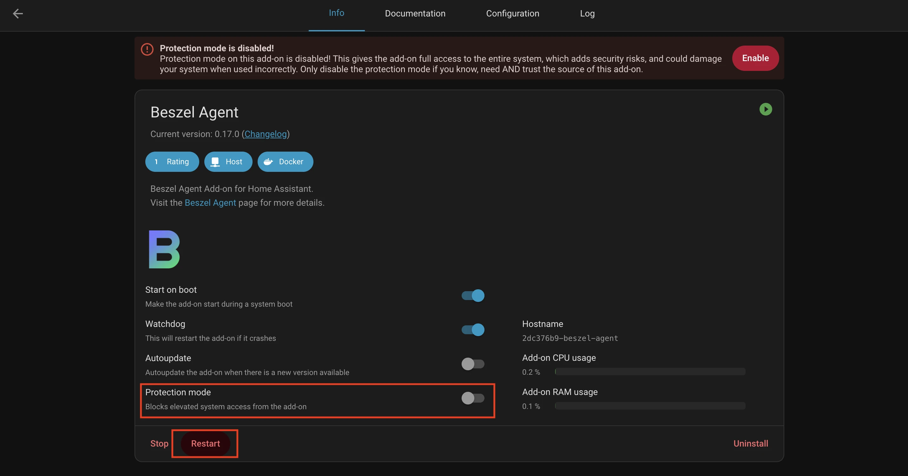

## 13. Verify Metrics in Beszel Hub

Open the Hub and confirm live readings and, where supported, disk health.

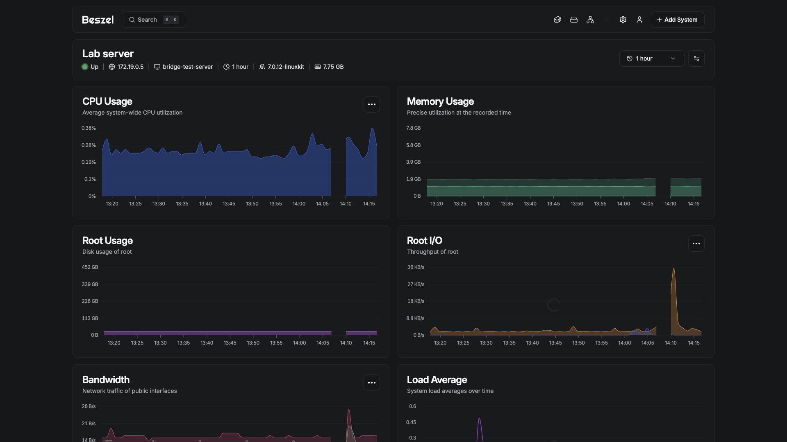

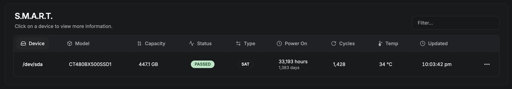

## Troubleshooting

- Check app logs first. For watchdog failures, check the Agent health endpoint on `45877` or the Hub's published port `8090`.
- For `CA_CERT_FILE` errors, verify the PEM file exists under `/ssl` and the option matches its path.
- For missing temperatures, check visibility of `/sys/class/hwmon/hwmon*/temp*_input` and `/sys/class/thermal/thermal_zone*/temp`.
- For GPU limitations, use the [variant guide](APPS.md). Report unresolved problems with versions and redacted logs in a [GitHub issue](https://github.com/vineetchoudhary/home-assistant-beszel-agent/issues).
