# Beszel dashboard setup

Complete [Bridge setup](../../../beszel_bridge/DOCS.md) and confirm its MQTT devices first. Choose the [overview](server-overview.yaml), [detail](server-detail.yaml) or [storage and SMART](storage-health.yaml) template. All use standard Home Assistant cards.

## Enable readings

The templates below use the default individual layout. For fewer entities, optionally set `group_entities: true` in the Bridge configuration and restart. SMART disks, containers and systemd services then keep one status/state entity each, with their properties in attributes. Adapt cards referencing their detail entities, or keep `group_entities: false` for individual charts. See [grouped entities and template sensors](../../../beszel_bridge/DOCS.md#optional-grouped-entities).

To enable all available readings at once, set `enable_all_entities: true` in the Bridge app's **Configuration**, save and restart it. This also enables existing entities disabled by the integration, preserving IDs, names, history and explicit user disables. Metric and system filters still apply. Turning the option off leaves existing settings intact.

Overview readings are enabled automatically. For an optional detailed reading, open your server under **Settings > Devices & services > MQTT**. Scroll to the bottom of **Sensors** and choose **+N disabled entities**. Diagnostic readings have their own disabled-entity list.

Select the reading, open its **Settings** cog and choose **Enable** in the notice at the top. Allow Home Assistant to reload the MQTT entities, then return to the information view to [check the value](../../screenshots/beszel-bridge/16-detail-enabled.webp). Home Assistant remembers your choice.

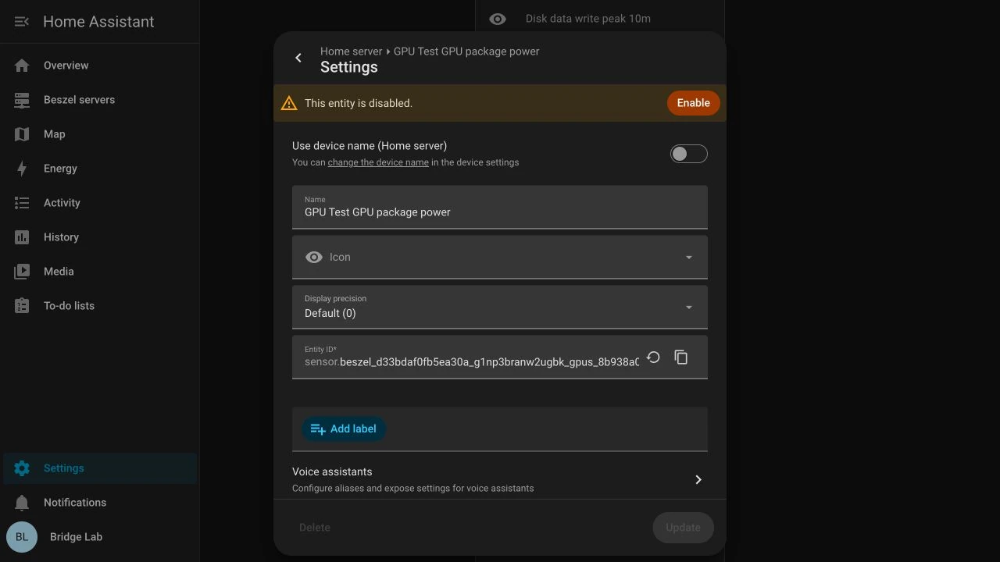

## Add a dashboard

### 1. Copy the entity IDs

Open the server under **Settings > Devices & services > MQTT**. Select a sensor, open its **Settings** cog and copy its complete Entity ID. Repeat for other readings and the Bridge device's diagnostics.

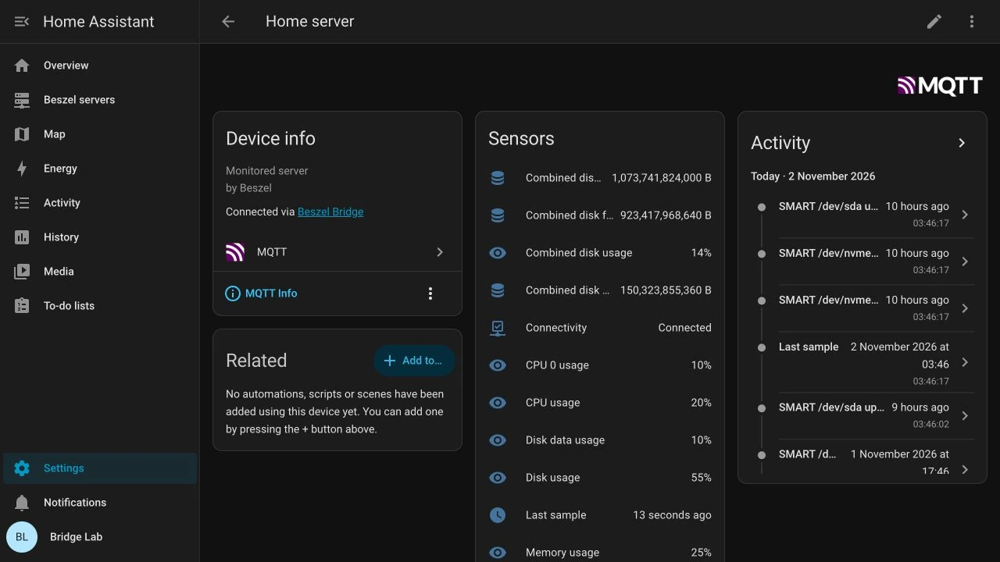

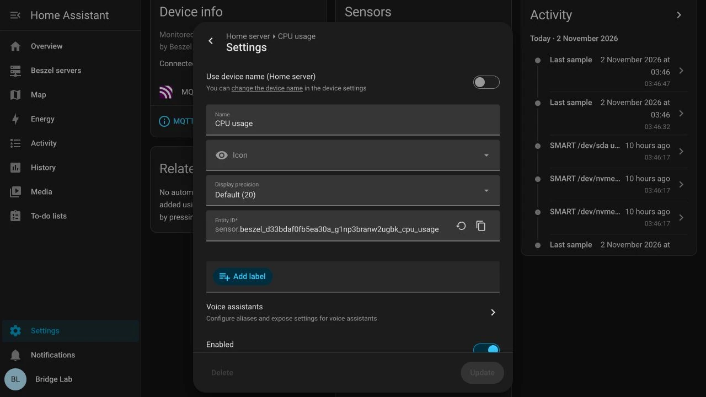

### 2. Create an empty dashboard

Open **Settings > Dashboards > Add dashboard > New dashboard from scratch**. Enter a title and a URL path such as `beszel-servers`, enable **Add to sidebar** and choose **Create**.

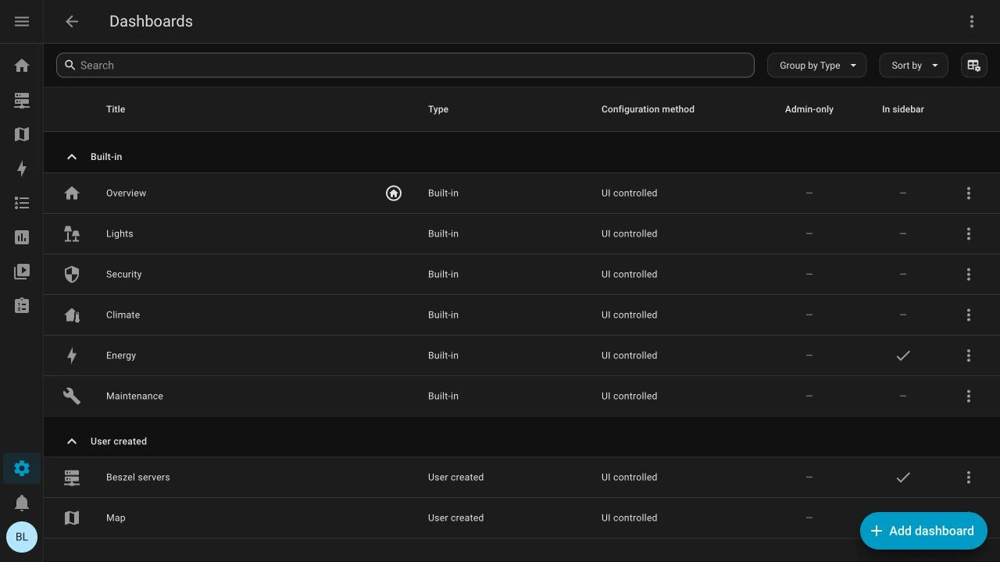

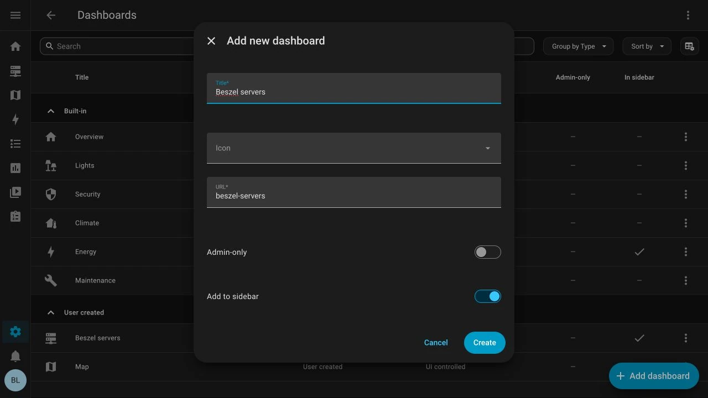

### 3. Open the raw configuration editor

Open the dashboard, choose **Edit dashboard**, then **⋮ > Raw configuration editor**. Take control of the dashboard first if prompted.

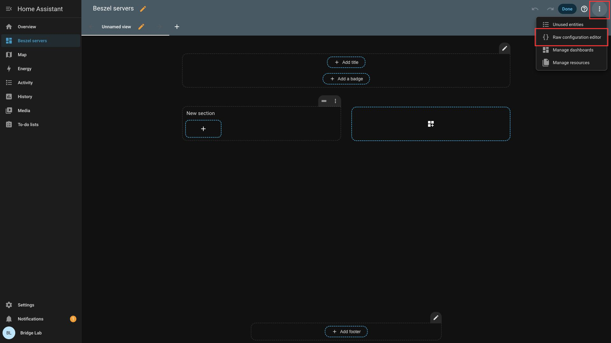

### 4. Paste a template and replace its placeholders

Paste one complete template. Replace every example ID beginning with `sensor.beszel_server`, `binary_sensor.beszel_server`, `sensor.beszel_bridge` or `binary_sensor.beszel_bridge` with the matching Entity ID from step 1. In the detail template, replace `BESZEL_HUB_URL` with your Hub's web address.

To combine templates, copy their view entries into one `views:` list. Keep a single `title:` and `views:` at the top level. In the storage template, replace the extra-filesystem and SMART placeholders with entities for your chosen filesystem and physical disk. Repeat those cards for additional disks.

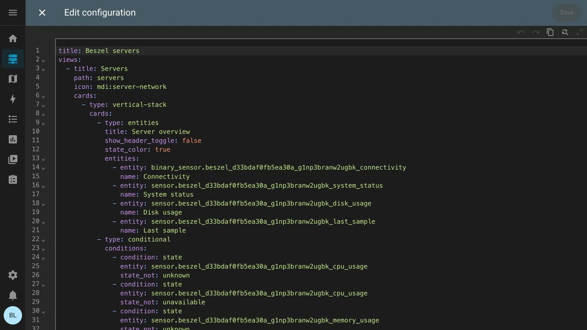

### 5. Save and check the readings

Choose **Save**, close the editor and choose **Done**. Check that readings appear. Combined templates provide **Servers**, **Server detail** and **Storage and SMART** tabs for the views you included.

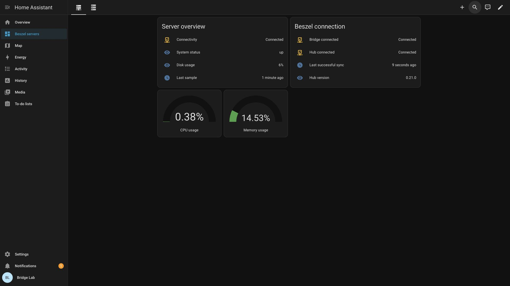

## Adjust the dashboard

For more servers, copy a card group and replace its Entity IDs. Always use IDs from Home Assistant because renaming or name collisions can change them.

Remove readings you have disabled or your hardware does not report. History starts when Home Assistant receives data. Older history stays in Beszel. If readings show **Unavailable**, check the [Bridge troubleshooting guide](../../../beszel_bridge/DOCS.md#troubleshooting).

To limit detailed history for this Bridge, set `history_retention_days` to your desired number of days, from `1` to `365`, in the app's configuration. It defaults to `0`, which leaves Home Assistant's retention unchanged. Positive values permanently delete older recorded states during daily cleanup. Statistics keep Home Assistant's own rules. Read the [retention notes](../../../beszel_bridge/DOCS.md#history-retention) before enabling it.

The detail template includes readable uptime and combined filesystem usage/free space. Combined values can double-count overlapping mounts or datasets. Configure `disk_aggregate_exclude` before relying on these totals.

For disk health, use the storage template's **SMART disk health** card with one disk's entities. Repeat it for each physical disk. To see its model, device path, type, firmware and serial, select **Overall status**, then choose **⋮ > Details**. The source timestamp is the Hub's disk-data timestamp; Home Assistant's own last-updated time describes when it received the entity update.

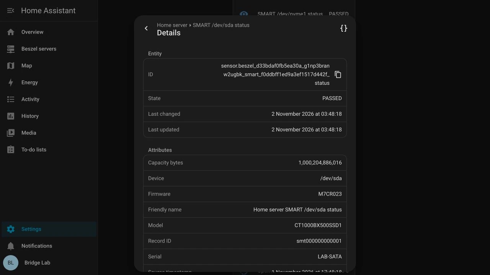

Detailed SMART attribute readings start disabled. Enable only those you want to chart or use in automations.

## Dashboard examples

These are real Home Assistant 2026.10.1 screens from the isolated end-to-end test. Hardware readings use [controlled example data](../../../beszel_bridge/testdata/expanded/monitoring.json), including the extra filesystem and SMART disks. See [capture details](../../screenshots/beszel-bridge/README.md).

### Server overview

### Server detail

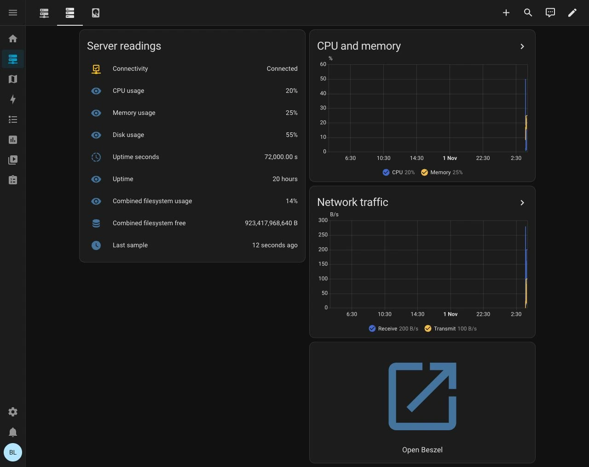

### Filesystems, SMART and uptime

The primary and data filesystems each have their own usage reading. Combined usage uses their capacities as weights. Physical SMART capacity is separate from these filesystem totals.

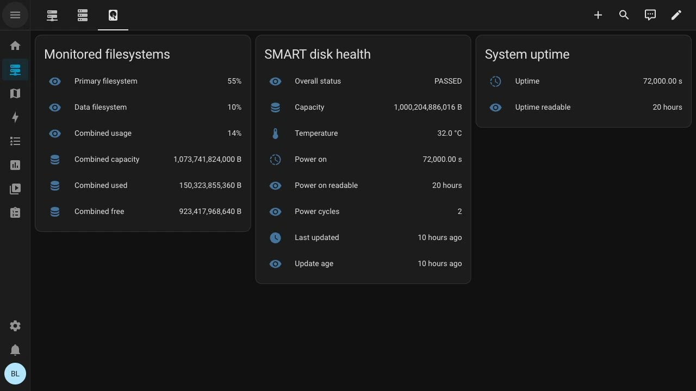

### Mobile layout

| Overview | Server detail |
| --- | --- |
| 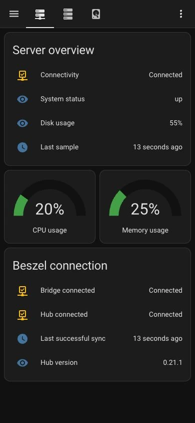 | 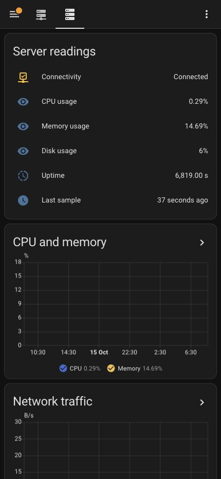 |

The storage template also stacks its filesystem, SMART and uptime cards on a narrow screen:

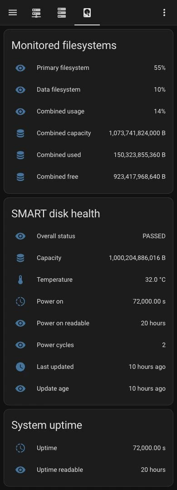
